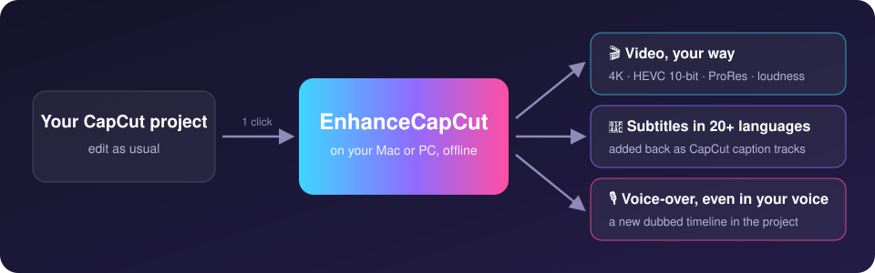
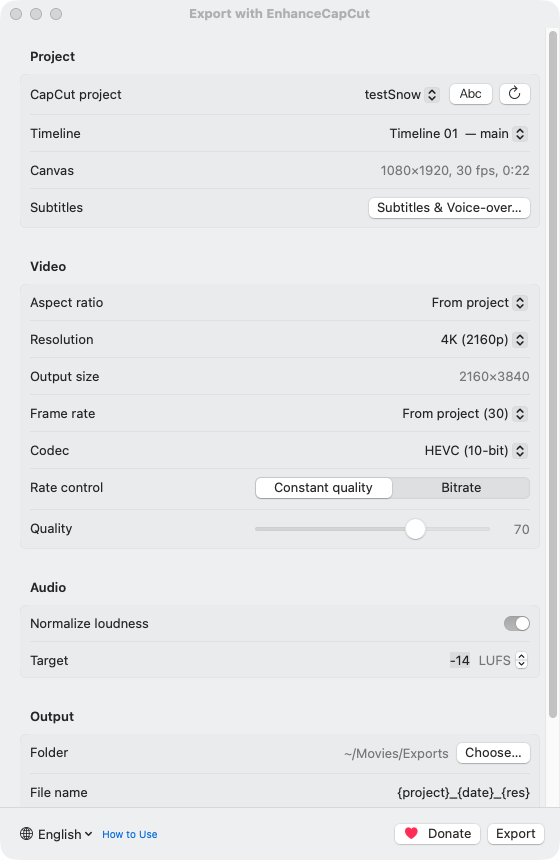
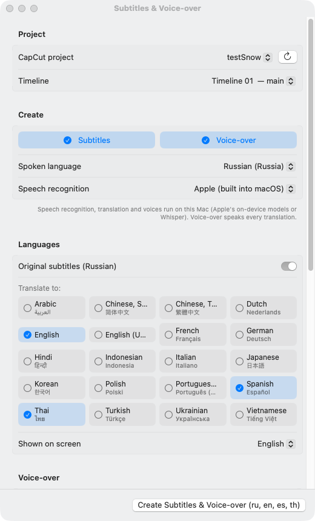
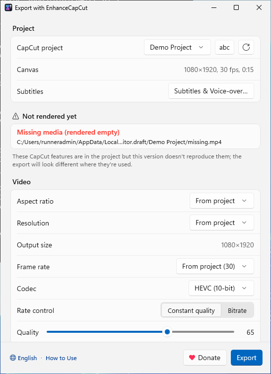
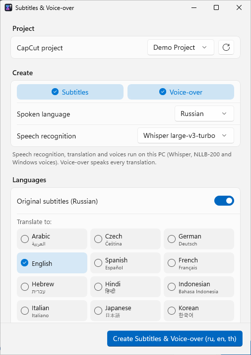
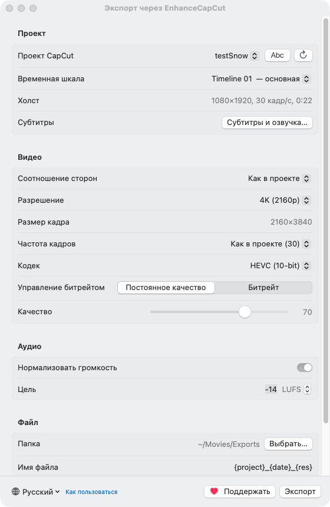
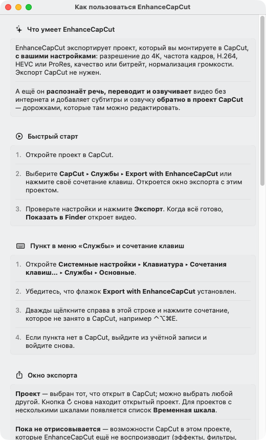

# EnhanceCapCut

**Your CapCut project, exported your way — and dubbed into any language, without leaving CapCut.**

[**Download**](../../releases/latest) · [Full guide](docs/USER-GUIDE.md) · [Command line](docs/CLI.md) · [Русский текст](docs/PROMO.ru.md)

 

EnhanceCapCut is a small free app that works **next to CapCut** on Mac and Windows. You keep editing in CapCut;
with one click EnhanceCapCut opens the project you're working on and

- **exports it with your own settings** — up to 4K, HEVC 10-bit or ProRes, exact quality or bitrate, loudness ready
  for YouTube, Instagram and TikTok;
- **adds subtitles in other languages and a voice-over back into the CapCut project** — transcribed, translated and
  spoken on your computer, even in the speaker's own voice.

  

## ✨ What you get

<table>
<tr>
<td width="50%" valign="top">

### 🎬 Export your way
Resolution up to **4K**, frame rate, **H.264, HEVC 8/10-bit, ProRes 422 / HQ**, constant quality or an exact
bitrate. Switch the aspect ratio (9:16, 1:1, 16:9) and the canvas is laid out again, like in CapCut.

### 🔊 Sound ready to publish
**Loudness normalization** to −14 LUFS (or any target): no more one video too quiet and the next one too loud.

### 🧭 No surprises
Before you export, the window lists the CapCut features your project uses that aren't rendered yet, and any media
files missing on disk.

</td>
<td width="50%" valign="top">

### 💬 Subtitles in 20+ languages
Speech is transcribed, translated and added to your project as **CapCut caption tracks** — one per language, styled
like your captions, editable in CapCut. `.srt` files too.

### 🎙 Voice-over
A voice for every language, previewed with ▶. Keep, lower or mute the original sound — or **remove just the
voice**, so the music and ambience stay. The dub goes to a **new timeline**; the original stays untouched.

### 🧬 Your own voice, any language
**Clone the original voice**: each line is spoken in the speaker's voice, with their intonation, in 20 languages —
only with the consent of the people speaking.

</td>
</tr>
</table>

🔒 **Private and offline** — speech recognition, translation and voices run on your Mac or PC; your video is never
uploaded. 🛟 **Safe** — every project is backed up before it's changed. 🌐 **English and Russian** interface.

## 📸 Screenshots

<table>
<tr>
<th>Export (Mac)</th>
<th>Subtitles &amp; voice-over (Mac)</th>
</tr>
<tr>
<td></td>
<td></td>
</tr>
<tr>
<th>Export (Windows)</th>
<th>Subtitles &amp; voice-over (Windows)</th>
</tr>
<tr>
<td></td>
<td></td>
</tr>
<tr>
<th>На русском: экспорт</th>
<th>На русском: встроенная справка</th>
</tr>
<tr>
<td></td>
<td></td>
</tr>
</table>

## 🚀 Get started

### Mac

1. Download `EnhanceCapCut-x.y.z.pkg` from [**Releases**](../../releases/latest) and open it. The app goes to
   `/Applications`. *(If macOS says the installer is from an unidentified developer, open **System Settings ▸ Privacy
   & Security** and click **Open Anyway**.)*
2. Launch EnhanceCapCut once, then in **System Settings ▸ Keyboard ▸ Keyboard Shortcuts… ▸ Services ▸ General** make
   sure **Export with EnhanceCapCut** is checked — and give it a hotkey, e.g. ⌃⌥⌘E.
3. While editing in CapCut, choose **CapCut ▸ Services ▸ Export with EnhanceCapCut** (or press the hotkey). Pick the
   settings, click **Export**.

### Windows

1. Download `EnhanceCapCut-x.y.z-windows-x64.zip` from [**Releases**](../../releases/latest) and unpack it to a folder
   you can write to (e.g. Documents — not Program Files, so updates can replace it).
2. Start `EnhanceCapCut.exe` *(if SmartScreen warns, click **More info ▸ Run anyway**)* and pin it to the taskbar.
3. While editing in CapCut, click the pinned icon: the export window opens with the project you're working on.

**Subtitles and voice-over:** close the project in CapCut (back to its home screen), click **Subtitles &
Voice-over…** in the export window, choose languages and voices, click **Create** — then open the project in CapCut
again. The app's built-in guide (**How to Use**, at the bottom of the export window) walks through every step; the
[full guide](docs/USER-GUIDE.md) has all the details.

Updates install from **Check for Updates…**; the app also checks once a day.

## ❓ FAQ

<b>Does it change CapCut or need a CapCut account?</b>

No. EnhanceCapCut doesn't patch or inject anything into CapCut. It reads the project files CapCut saves on your disk,
renders them with its own engine, and — for subtitles and voice-over — writes new tracks into the project, after a
backup.

<b>Will the export look exactly like CapCut's?</b>

Cuts, overlays, speed (incl. curves), transforms and keyframes, canvas backgrounds, photos, compound clips, texts and
captions and the audio mix (incl. CapCut's voice isolation, noise reduction and voice filters) are rendered. CapCut
effects, filters, transitions, stickers and text animations are not yet — the export window tells you when your
project uses them. See the [roadmap](docs/PLAN.md).

<b>Is my video uploaded anywhere?</b>

No. Speech recognition, translation and voices run on your computer (Apple's on-device models or Whisper on the Mac;
Whisper, NLLB and Windows voices on Windows). The models are downloaded once, the first time they're needed. The
internet is used only for that, for updates and for the list of ways to donate.

<b>What do I need?</b>

macOS 15 or later (Apple Silicon recommended; subtitles and voice-over need macOS 26), or Windows 10/11 x64. On the
Mac, loudness normalization needs `ffmpeg` (`brew install ffmpeg`); on Windows it's built in.

<b>Can I clone anyone's voice?</b>

Only your own, or the voice of people who agreed to it. The app asks you to confirm their consent before every run.

<b>Is there a command line?</b>

Yes — `ecc` renders projects and adds subtitles from scripts. See [docs/CLI.md](docs/CLI.md).

## ❤️ Support

EnhanceCapCut is free. If it saves you time, the **♥ Donate** button next to **Export** shows the ways to support it.
Bugs and ideas are welcome in [Issues](../../issues).

## 🛠 For developers

Build, test and release: [docs/DEVELOPMENT.md](docs/DEVELOPMENT.md) · conventions: [CLAUDE.md](CLAUDE.md) ·
Windows version: [windows/README.md](windows/README.md) · CapCut's project format: [docs/FORMAT.md](docs/FORMAT.md).

EnhanceCapCut is an independent app and is not affiliated with CapCut or ByteDance. No CapCut resources (shaders,
Lua, LUTs, fonts) and no user media or project files are part of this repo.
